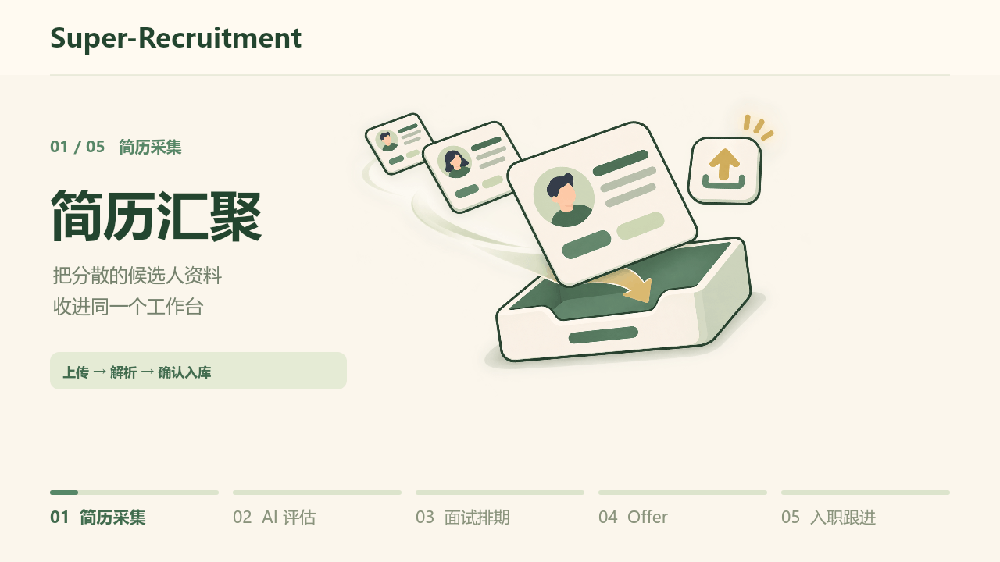
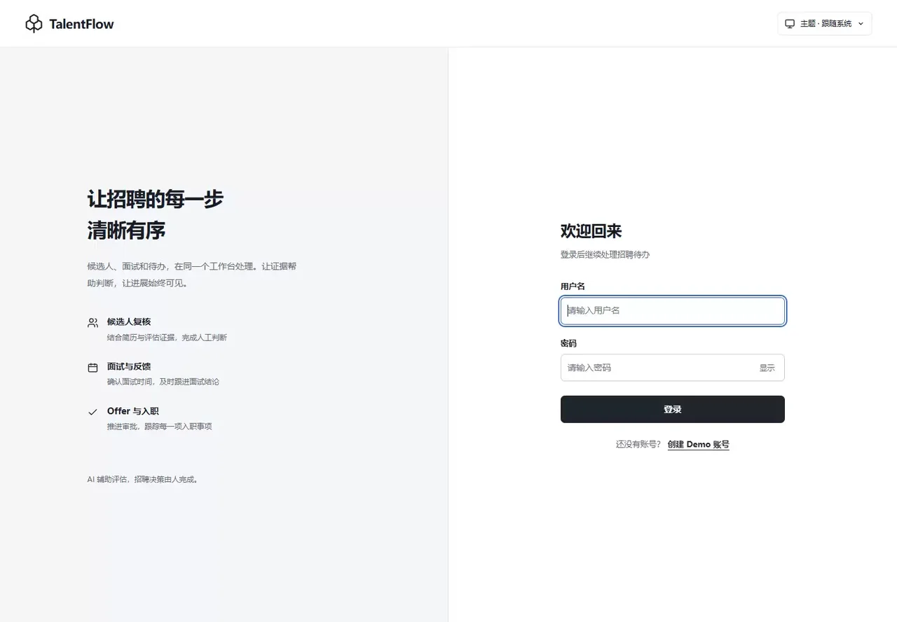
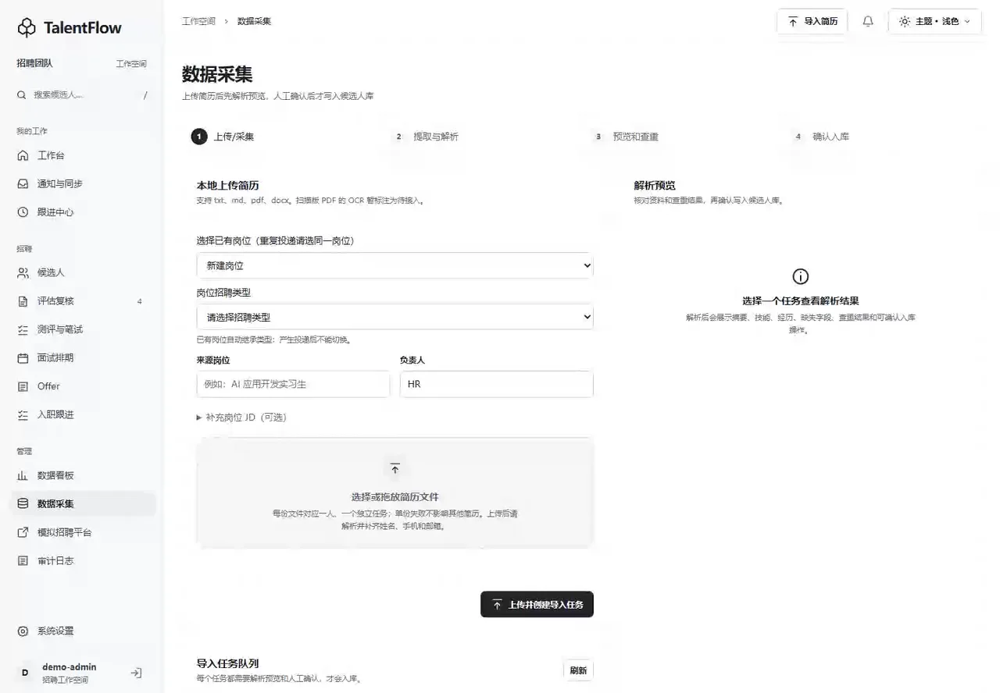
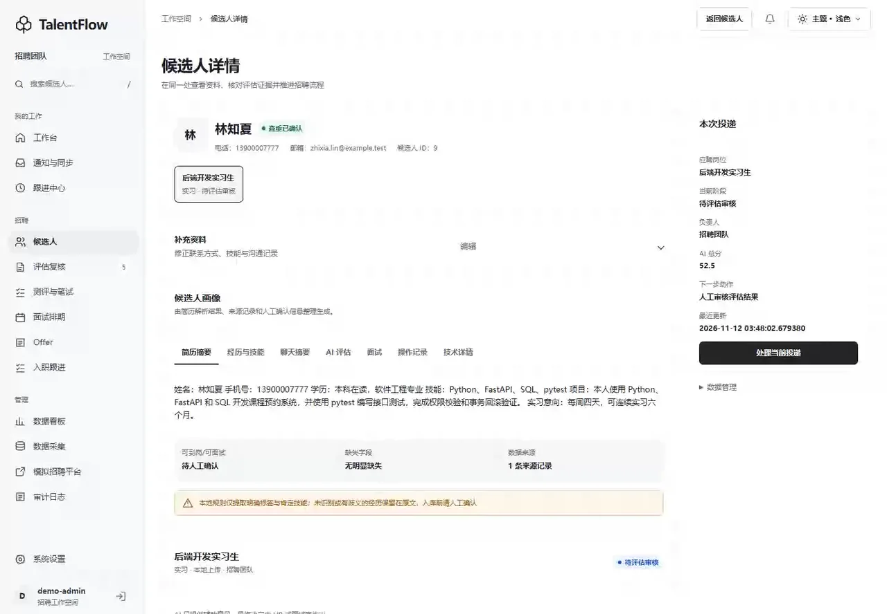
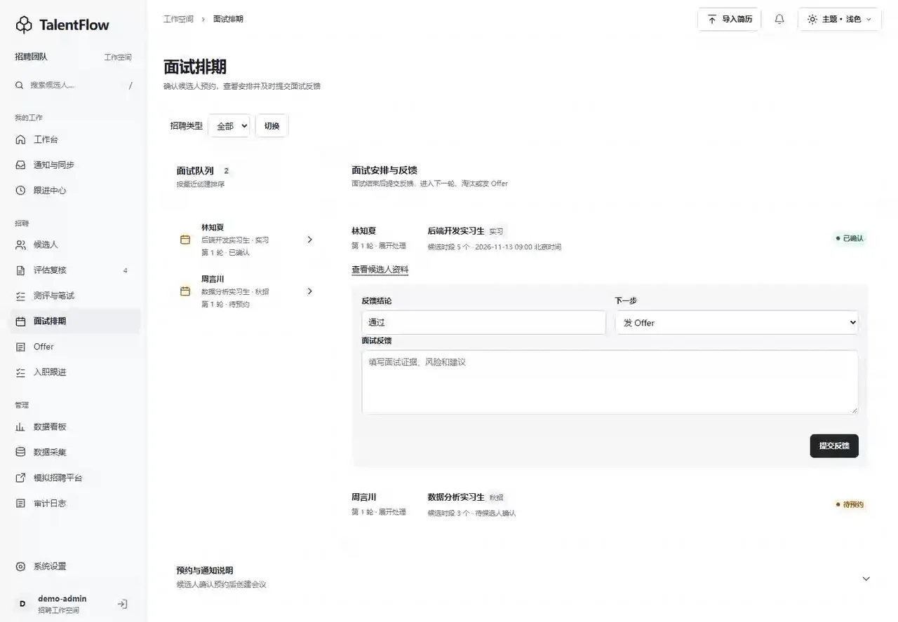
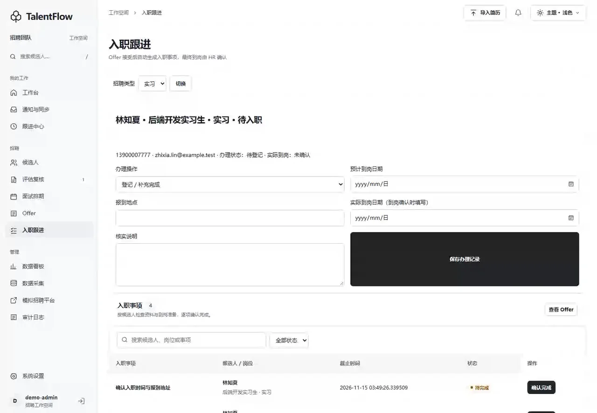

<div align="center">

<h1>Super-Recruitment</h1>

<p><strong>从简历到入职，清晰推进每一步。</strong></p>

<p>面向 HR 的招聘工作台，以 AI 辅助解析和评估，用人工审批推进面试、Offer 与入职。</p>

<p>
  
  
  
  
</p>

<p><a href="#预览">预览</a> · <a href="#功能特性">功能特性</a> · <a href="#安装与配置">安装与配置</a> · <a href="#运行">运行</a> · <a href="#项目结构">项目结构</a></p>

</div>

## 预览

<p align="center">
  
</p>

以下为各个功能的预览

<details>
<summary>1. 登录与工作台：岗位筛选、看板 / 列表与主题切换</summary>



</details>

<details>
<summary>2. 数据采集与解析：上传简历、补全资料、确认入库</summary>



</details>

<details>
<summary>3. AI 评估与排期：复核评估、生成时段、候选人预约</summary>



</details>

<details>
<summary>4. 面试反馈与 Offer：填写反馈、审批条款、候选人接受</summary>



</details>

<details>
<summary>5. 入职跟进与审计：完成事项、确认到岗、查看月历与日志</summary>



</details>

## 功能特性

- **简历采集与整理** — 从模拟招聘平台采集，或上传 TXT、Markdown、PDF、DOCX 简历；提取内容、识别缺失字段，支持人工补充与姓名、手机号查重。
- **有依据的 AI 评估** — 对照岗位 JD 生成结构化评分、匹配证据与待核实项；支持 OpenAI-compatible 模型接口，评估结果交由 HR 复核。
- **按投递推进招聘** — 同一候选人可投递多个岗位，分别记录进度；支持秋招与实习，实习初筛通过后自动跳过测评、笔试环节，进入面试。
- **面试预约与反馈** — 生成候选时段和公开预约链接，收集多轮面试反馈；可选接入腾讯会议，支持建会、改期、取消及结果未知时的查询核实。
- **Offer 与入职衔接** — 生成草稿和审批摘要，人工审批后发放；候选人在线接受或拒绝，接受后自动生成入职任务，由 HR 确认到岗。
- **工作台与招聘看板** — 按招聘阶段查看候选人，支持关键词、岗位筛选与看板/列表切换；提供今日面试、内部面试月历、漏斗统计、浅色与深色主题。
- **跟进、通知与导出** — 跟踪超时任务，支持 SMTP 邮件、企业微信群机器人通知和 XLSX/CSV 导出；导出文件可人工上传至腾讯文档。
- **记录可追溯** — SQLite 保存业务状态与审计日志；管理端需要登录，个人发件邮箱按 HR 账号配置，模型密钥可在设置页保存或清除。

AI 提供辅助意见，筛选、面试结论、Offer 和到岗确认保留人工决策。

## 安装与配置

推荐使用 **Windows、PowerShell、Python 3.11 和 Conda**。前端由 Jinja2 模板与原生 JavaScript 提供，无需单独构建；运行前端测试时需要 **Node.js**。

### 1. 安装

```powershell
git clone https://github.com/IT-coder-Yy/Super-Recruitment.git
cd Super-Recruitment
.\scripts\setup.ps1
```

安装脚本会创建或复用 `testin` Conda 环境、安装 [requirements.txt](requirements.txt)，并在 `.env` 不存在时复制 [.env.example](.env.example)。模型、邮箱和会议服务按下方说明配置。

<details>
<summary>不使用 Conda：手动安装</summary>

先准备 Python 3.11，再执行：

```powershell
python -m venv .venv
.\.venv\Scripts\python.exe -m pip install -r requirements.txt
if (-not (Test-Path .env)) { Copy-Item .env.example .env }
.\.venv\Scripts\python.exe -m uvicorn app.main:app --host 127.0.0.1 --port 8000
```

</details>

### 2. 按需连接服务

| 服务 | 配置项 | 配置说明 |
| --- | --- | --- |
| **AI 模型** | `LLM_PROVIDER`、`LLM_BASE_URL`、`LLM_MODEL`、`LLM_API_KEY` | 填写兼容接口地址、模型与密钥，并选择 `openai_compatible` 后启用在线评估。 |
| **腾讯会议 · 可选** | `MEETING_PROVIDER`、`TENCENT_MEETING_TOKEN` | 设置 `tencent_mcp` 并提供个人 Token 后启用真实会议，单独填写 Token 不会启用。 |
| **邮件 · 可选** | `SMTP_HOST`、`SMTP_PORT`、`SMTP_SSL`、`SMTP_USERNAME`、`SMTP_PASSWORD`、`SMTP_FROM` | 配置发件服务器与账号，用于发送预约和 Offer 邮件。 |
| **企业微信 · 可选** | `WECOM_WEBHOOK_URL` | 配置企业微信群机器人 Webhook，用于发送内部通知。 |
| **公开访问地址** | `APP_PUBLIC_BASE_URL` | 生成候选人预约与 Offer 链接，默认 `http://127.0.0.1:8000`；跨设备使用时应改为候选人能够访问的地址。 |
| **本地存储与会话** | `DATABASE_URL`、`APP_SECRET_KEY` | 默认使用本地 SQLite；共享部署前更换示例会话密钥。 |

模型和企微的网页设置保存在 `data/runtime.env`，首次运行时从环境变量或 `.env` 导入。已有安装优先通过 **系统设置** 修改这些配置。在线模型调用失败会报告错误。

腾讯会议模式和 Token 在部署环境或 `.env` 中配置，修改后重启。真实会议请求不自动重试；建会、改期或取消结果未知时，先在排期页查询核实，避免重复创建。

<details>
<summary>邮箱配置与个人发件账号</summary>

部署默认邮箱写入 `.env`，修改后重启。以 QQ 邮箱为例：

```dotenv
SMTP_HOST=smtp.qq.com
SMTP_PORT=465
SMTP_SSL=true
SMTP_USERNAME=你的完整QQ邮箱
SMTP_PASSWORD=QQ邮箱生成的SMTP授权码
SMTP_FROM=同一个QQ邮箱
```

每位 HR 也可以在 **系统设置 → 邮件 → 我的发件邮箱** 保存个人配置。发信优先使用当前 HR 的个人配置，未设置时使用部署默认。个人配置错误不会切换到其他发件账号；清除个人配置后恢复部署默认。

个人配置存放于 `data/users/<用户ID>/smtp.runtime.env`。页面不回显授权码；保留当前服务器和账号时，密码留空可沿用已保存的个人授权码，首次配置必须填写。SMTP 的 `SENT` 表示服务器接受邮件，实际收件仍需确认。

</details>

### 3. 了解数据边界

- **本地数据**：数据库、上传文件、导出和运行配置默认位于 `data/`；迁移时保留该目录，包括个人邮箱配置。密钥保存在本机配置文件中，未提供额外的静态加密。
- **账号与权限**：管理页面和 API 需要登录；当前允许自行注册，候选人的预约与 Offer 链接按 Token 公开访问。登录能力不等于完整的企业权限体系。
- **人工审批**：在线评估前对手机号和邮箱脱敏；薪资、职级与预计入职日期由 HR 填写，模型只辅助生成草稿和摘要。
- **月历与导出**：项目内月历无需外部日历服务，XLSX/CSV 导出也不代表已同步腾讯文档。

## 运行

```powershell
.\scripts\start.ps1
```

打开 [管理端](http://127.0.0.1:8000)，使用种子演示账号 **`demo-admin` / `demo123456`** 登录，或自行注册。注册成功后需要返回登录页登录；已有数据库缺少演示账号时，可运行 `conda run -n testin python -m app.seed`。

首次演示可按以下顺序操作：

1. 在 **模拟招聘平台** 采集虚构候选人，或在 **数据采集** 上传 [模拟简历](samples/resumes)。
2. 解析并补充缺失字段，确认入库后启动 **AI 评估**，查看评分依据并人工复核。
3. 在 **面试排期** 生成时段，打开候选人预约链接完成预约，再提交面试反馈。
4. 创建并审批 **Offer**，通过候选人链接接受或拒绝；接受后进入 **入职跟进**。
5. 查看 **跟进中心、数据看板与审计日志**，按需导出 XLSX/CSV。

接口说明见 [API 文档](http://127.0.0.1:8000/docs)，服务状态见 [健康检查](http://127.0.0.1:8000/health)。停止本项目服务可运行 `.\scripts\stop.ps1`。

<details>
<summary>可选 Docker 启动</summary>

仓库提供 Docker 配置；Docker 运行环境需单独验证。

```powershell
if (-not (Test-Path .env)) { Copy-Item .env.example .env }
docker compose up --build
```

访问 [管理端](http://127.0.0.1:8000)。Compose 从 `.env` 读取配置，并将 `./data` 挂载到容器 `/app/data`，保留数据库、上传、导出和运行配置。

</details>

## 项目结构

```text
app/
├── main.py                 # FastAPI 路由、页面与应用生命周期
├── config.py               # 模型、集成服务和个人邮箱配置
├── db.py                   # 数据库连接与会话
├── models.py               # 候选人、投递、面试、Offer 等数据模型
├── migrations.py           # 既有数据库升级
├── seed.py                 # 虚构演示数据与演示账号
├── workbench.py            # 工作台汇总与候选人看板
├── interview_calendar.py   # 内部面试月历
├── ai/                     # 模型客户端、提示词与评估服务
├── adapters/               # 会议与企业微信通知适配
├── services/               # 采集、审批、排期、Offer、入职与导出
├── templates/              # Jinja2 管理端和候选人页面
└── static/                 # 原生 JavaScript、样式与图标
scripts/                    # 安装、启停、测试与备份恢复工具
tests/                      # Python 和 JavaScript 测试
samples/resumes/            # 可上传的虚构简历
demo/                       # 功能预览与操作录屏
```
